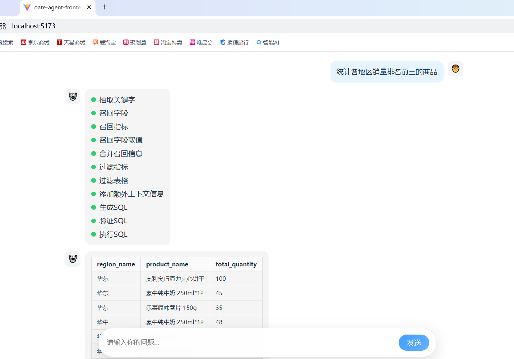

# 企业级 NL2SQL 问数智能体

#### 介绍

基于大模型的企业级 NL2SQL 智能问答系统，让业务人员用自然语言直接查询数据库，告别"找不到表、看不懂字段、不会写 SQL"的痛点。后端使用 Python 开发，支持 Docker 一键部署。

## 🛠️ 技术栈

| 层级 | 技术 |
|------|------|
| 后端框架 | FastAPI + AsyncIO |
| Agent 编排 | LangGraph / LangChain |
| 向量数据库 | Qdrant |
| 全文检索 | Elasticsearch |
| 关系型数据库 | MySQL |
| Embedding | bge-large-zh-v1.5 |
| LLM 接入 | LiteLLM（兼容 OpenAI / 通义千问 / DeepSeek 等） |
| 链路追踪 | Langfuse（可选） |
| 前端 | Vue 3 + Vite |
| 部署 | Docker + Docker Compose |

## 📁 项目结构

```
data-agent/
├── app/
│   ├── agent/              # Agent 编排（LangGraph 图定义 + 节点）
│   │   └── nodes/          # 各流程节点（召回/过滤/生成/校验/纠错等）
│   ├── api/                # FastAPI 路由与请求模型
│   ├── clients/            # 各类客户端封装（embedding、ES、Qdrant、MySQL）
│   ├── conf/               # 配置管理
│   ├── core/               # 核心组件（生命周期、日志、上下文、链路追踪）
│   ├── entities/           # 实体定义
│   ├── models/             # ORM 模型
│   ├── prompt/             # Prompt 加载器
│   ├── repositories/       # 数据访问层（MySQL / ES / Qdrant）
│   ├── scripts/            # 工具脚本（元数据构建等）
│   └── services/           # 业务服务层
├── conf/                   # 运行配置文件（含示例配置）
├── docker/                 # Docker 部署配置
├── docs/                   # 文档与截图
├── frontend/               # 前端（Vue 3 + Vite）
├── prompts/                # 各节点 Prompt 模板
├── main.py                 # 后端服务入口
├── pyproject.toml          # 依赖管理（uv）
└── uv.lock                 # 依赖锁定文件
```

## 🏗️ 软件架构

```
用户提问
  │
  ▼
┌─────────────────────────────────┐
│ 关键词提取 (extract_keywords)    │
└────────────────┬────────────────┘
                 │
   ┌─────────────┼─────────────┐
   ▼             ▼             ▼
字段向量召回   指标向量召回   枚举值召回
  (Qdrant)      (Qdrant)     (Elasticsearch)
   │             │             │
   └─────────────┼─────────────┘
                 ▼
        ┌──────────────────┐
        │ 结果融合 (RRF)     │
        └────────┬─────────┘
                 ▼
        ┌──────────────────┐
        │ 表/指标过滤剪枝    │
        └────────┬─────────┘
                 ▼
        ┌──────────────────┐
        │ SQL 生成 (LLM)    │
        └────────┬─────────┘
                 ▼
        ┌──────────────────┐   失败    ┌──────────────┐
        │ SQL 语法校验      │─────────▶│ SQL 纠错      │
        └────────┬─────────┘           └──────┬───────┘
                 │ 成功                       │
                 ▼                            │
        ┌──────────────────┐                  │
        │ SQL 执行 & 返回   │◀─────────────────┘
        └──────────────────┘
```

## ✨ 核心特性

- **多阶段推理架构**：基于 LangGraph 构建多节点有向图工作流，重写 → 召回 → 过滤 → 生成 → 校验 → 纠错，全链路可控
- **混合多路召回**：Qdrant 向量检索 + Elasticsearch 倒排索引 + RRF 融合，字段召回命中率高
- **Schema 动态剪枝**：通过 CoT 思维链动态筛选相关表和字段，压缩 Prompt 并提升 SQL 生成准确率
- **SQL 自纠错闭环**：自动语法校验 + 智能纠错，提升端到端 SQL 可执行率
- **流式响应**：SSE 流式输出，打字机效果，体验流畅
- **链路追踪**：可选接入 Langfuse，完整观测 LLM 调用链路

## 🚀 快速开始

### 1. 启动基础设施

```bash
cd docker
docker compose up -d
```

会启动：MySQL（业务库 + 元数据库）、Qdrant、Elasticsearch、Embedding 服务。

### 2. 配置应用

复制示例配置并按需修改：

```bash
cp conf/app_config.example.yaml conf/app_config.yaml
```

> `conf/app_config.yaml` 已被 `.gitignore` 忽略，不会提交到仓库。

### 3. 安装依赖

```bash
uv sync
```

### 4. 构建元数据知识库

```bash
uv run python -m app.scripts.build_meta_knowledge --conf conf/meta_config.yaml
```

### 5. 启动后端服务

```bash
uv run python main.py
```

服务启动后访问 http://localhost:8000/docs 查看 API 文档。

### 6. 启动前端

```bash
cd frontend/data-agent-fronted
npm install
npm run dev
```

## 📊 效果展示



## 💡 设计亮点

1. **三路并行召回 + RRF 融合**：字段语义走向量、精确值走 ES、业务指标单独建库，三路结果用倒数排名融合，兼顾语义理解和精确匹配
2. **Schema 动态剪枝**：不是把所有表结构全塞给 LLM，而是先推理筛选，既省 Token 又减少干扰
3. **多阶段而非端到端**：每一步都有明确的输入输出和校验，出错可定位可修复，比一次性生成 SQL 靠谱得多
4. **元数据三层架构**：结构化（MySQL）+ 向量化（Qdrant）+ 全文（ES），各司其职
5. **可观测性**：通过 Langfuse 可开关的链路追踪，便于排查 LLM 调用问题与成本分析